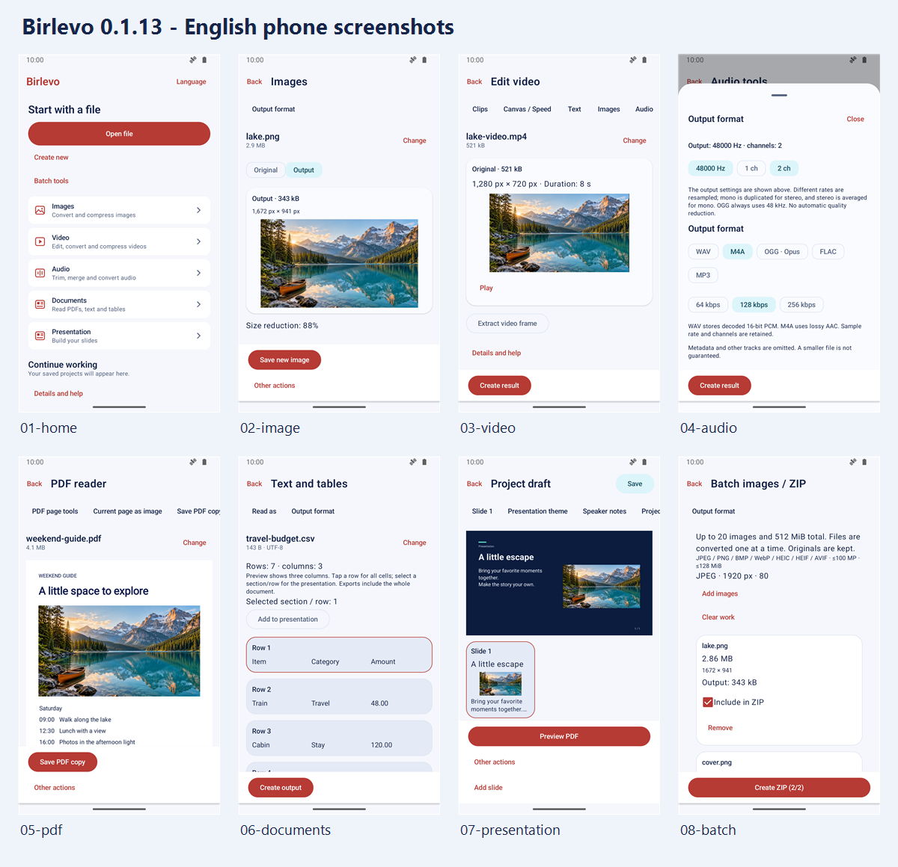

# Google Play phone screenshots

The refreshed listing package contains **eight English screenshots** from the existing signed Birlevo **0.1.13 / version code 14** application. The publisher requested an English-only package. No application version, production code, dependencies, advertising activation flags or signed release artifacts were changed for this graphics task.



The contact sheet is for review only. Upload the individual full-resolution PNGs from the local package.

## Upload package

- [Eight-image ZIP](../../output/play-store/0.1.13/birlevo-0.1.13-english-only.zip)
- [Clean Birlevo-only folder](../../output/play-store/0.1.13/birlevo-0.1.13-english/)
- [Upload instructions](../../output/play-store/0.1.13/UPLOAD.md)
- [Pixel, format and identity validation](../../output/play-store/0.1.13/validation.json)
- [Demo input provenance](../../output/play-store/0.1.13/input-provenance.json)

These generated files remain outside Git. The ZIP has one unique top-level folder, `birlevo-0.1.13-english`, containing `01-home.png` through `08-batch.png`, `UPLOAD.md` and `validation.json`; it contains no other locale, test APK, raw captures or contact sheet. On 2026-10-19 its size was 3,933,584 bytes and SHA-256 was `472da79bee3bb3b9bdaab069502249c786b40f501b8fc84f74ffe277fd84b16b`.

The first package used a generic `en-US` folder. The publisher's Downloads directory already contained `en-US/phone` and `en-US/tablet` from the 2026-10-15 Folklore Archive screenshot package. Extracting into the same parent left both apps' files together. Inspection confirmed those nested folders were not in the Birlevo ZIP, and all eight extracted Birlevo PNG hashes matched their source captures. The replacement archive has an app-specific name and folder to prevent that collision; use the clean folder for uploading. The existing Folklore Archive assets were left in place.

| Order | File | Actual application view |
| --- | --- | --- |
| 1 | `01-home.png` | File-focused home and tool categories |
| 2 | `02-image.png` | Actual image compression result and source/output sizes |
| 3 | `03-video.png` | Imported video preview and editing actions |
| 4 | `04-audio.png` | Output format, sample rate, channel and bitrate controls |
| 5 | `05-pdf.png` | Sample PDF in the reader |
| 6 | `06-documents.png` | Sample CSV table in the text/table reader |
| 7 | `07-presentation.png` | Edited slide with text, scenic image and Ocean theme |
| 8 | `08-batch.png` | Actual processed image queue and ZIP action |

All eight files are **1080 × 1920, 9:16, 24-bit RGB PNG without alpha**, below 8 MiB each. The upload RGB pixels equal the on-device captures exactly. Conversion removes the unused alpha channel without changing colors, cropping, resizing, adding claims or drawing substitute interface elements. The image's displayed reduction is a measured result for this sample, not a general compression guarantee. Long action rows and document/queue content remain naturally scrollable; the audio screenshot intentionally shows its settings panel.

The listing graphics can be updated independently of a new application build. In Play Console, open the English main store listing under **Grow users → Store presence → Store listings**, replace the phone screenshots in numbered order, check previews and save/submit the graphics change. The new app icon is a separate field. Nothing was uploaded to Play Console by this workflow. See Google's [preview asset guidance](https://support.google.com/googleplay/android-developer/answer/9866151?hl=en).

## Capture method and verification

The standalone [platform instrumentation](../../app/src/androidTest/java/com/example/contentstudio/StoreCaptureInstrumentation.java) launches the installed application, changes its actual application locale to English and navigates using accessibility text. A separate [read-only fixture provider](../../app/src/androidTest/java/com/example/contentstudio/StoreFixtureProvider.java) supplies only allowlisted synthetic demo files. File-picker results are supplied by the harness; imports, processing, document rendering, slide editing and UI pixels come from the actual signed app.

The providers and runner live exclusively in `androidTest`. The default AndroidX runner and release-smoke selection remain available. `-Pbirlevo.storeCapture=true` selects only the independent capture runner. The [capture script](../../tools/testing/capture-store.ps1) builds/signs that test APK, verifies and installs the frozen application, captures scenes, exports RGB PNGs and requires both a scene pass marker and successful instrumentation result. It only permits the `ofice_qa` emulator and clears only that QA app's data unless `-KeepQaData` is selected. It restores the dedicated emulator's display defaults and exits System UI demo mode in `finally`.

For the recorded run:

- Dedicated `ofice_qa`, API 36, x86_64, light mode; capture size 1080 × 1920, density 420, font scale 1.0. Demo status bar: 10:00, full battery, hidden notification icons.
- Every English scene passed against the installed code-14 app. All eight final screenshots were visually inspected; programmatic validation checked dimensions, PNG color type, file size, raw RGB pixel equality and per-scene instrumentation results.
- Pulled installed `base.apk` matched the frozen signed APK byte-for-byte: SHA-256 `4b45af17f393e733b17d4852e48b9622ce7299386795762451a294f4575dbbd9`. Its application source commit is `3f49d34c35448105c5dacb42f510cee2f4ac6d5e`.
- Only the test harness was built. The original signed APK/AAB were retained. Existing live advertising activation gates stayed disabled.
- Initial harness compile/runner-selection diagnostics and the first presentation theme-navigation failure were preserved locally. The final runner selects the theme dropdown before its item; the final scene logs all passed. No failed capture was substituted into the package.
- After capturing, QA display overrides/demo mode were reset and the headless emulator was stopped. No personal device or daily-use emulator was modified.

This is store-asset verification, not a new full release regression or a physical-device performance qualification.

To repeat with the saved synthetic inputs under `output/play-store/0.1.13/inputs`, the frozen release evidence and the dedicated QA emulator running:

```powershell
tools/testing/capture-store.ps1 -Version 0.1.13 -Serial emulator-5580 -Locales en-US
```

Use `-SkipHarnessBuild` only when the test APK was already built from the intended source. A future application version needs its own identity checks and new captures; do not relabel code-14 screenshots as a later UI.

## Demo media provenance

All content was prepared for this task; no personal media or third-party document samples were used. The CSV is a small authored travel budget. The two-page PDF is generated by the test provider with Android `PdfDocument`. The PCM melody was synthesized locally; the eight-second H.264/AAC video uses that melody and the scenic input image. `cover.png` is the existing owned Birlevo design source. The local provenance file records the input hashes.

The scenic input was generated with the **built-in image generation tool**, not a CLI/API-key fallback. It is a synthetic illustration rendered as a photograph, used only as file content inside actual UI. Actual output dimensions were **1672 × 941**. The exact prompt was:

> Create an original photorealistic landscape photograph to serve only as a synthetic demo input inside a file editing app. Wide landscape 16:9 composition, high detail, natural realistic colors. A calm turquoise alpine lake with pine forests, distant layered mountain peaks and warm early-morning sunlight. A small burnt-orange wooden canoe rests near the shore in the lower-left third. Rich but restrained blue/teal/orange colors, clear water reflections, balanced exposure, fine texture in trees and mountains. The lake and mountain scenery fill the frame naturally. No people, no text, no letters, no logos, no watermark, no app UI, no device frame, no borders, no collage. Output one clean wide photo, preferably 2048x1152.

The UI screenshots themselves were never generated or redrawn by an image model.
